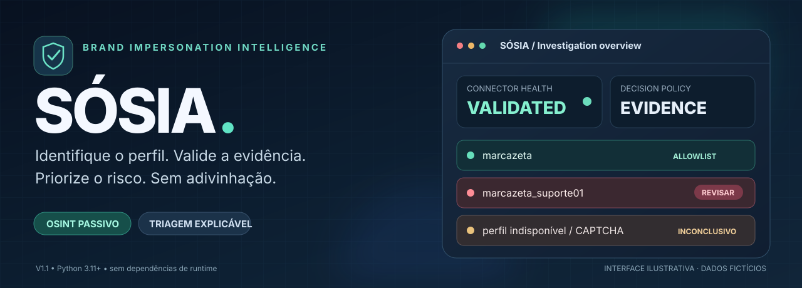
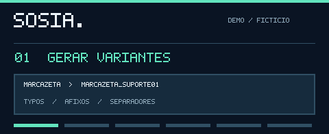
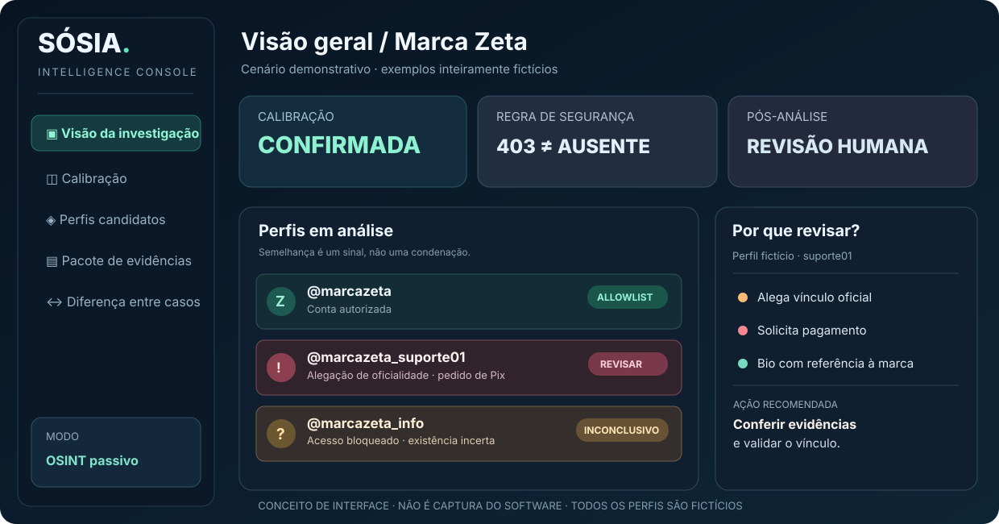
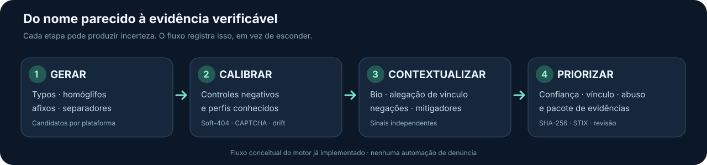

<div align="center">



<br />

[](https://github.com/Ridd1kulusC0d3r/SOSIA/actions/workflows/test.yml)


[](LICENSE)

[](https://colab.research.google.com/github/Ridd1kulusC0d3r/SOSIA/blob/claude/laughing-davinci-bj48ot/notebooks/sosia_colab.ipynb)

**Investigação explicável de possíveis perfis impostores, com calibração por plataforma e evidências auditáveis.**

[Visão geral](#visão-geral) · [Demonstração](#demonstração-visual) · [Instalação](#comece-aqui) · [Casos](#casos-de-investigação) · [Validação](#resultados-e-validação) · [Arquitetura](#arquitetura-e-documentação)

</div>

> **Colab:** `notebooks/sosia_colab.ipynb` instala o pacote, gera variantes, lê bios offline, calibra/valida os conectores no seu IP, varre, mostra o relatório e baixa o pacote de evidências. Células com 🌐 usam rede. O link do badge aponta para a branch de desenvolvimento; ajuste para `main` após o merge.

---

## Visão geral

**Um username parecido não é prova de fraude. Um HTTP 200 não confirma a existência de um perfil. Um CAPTCHA não significa que a conta não existe.**

O SÓSIA é uma ferramenta de **Brand Impersonation Intelligence** com abordagem OSINT passiva. Ela gera variantes plausíveis de nomes de marcas, testa a confiabilidade de conectores, consulta sinais públicos disponíveis, interpreta o contexto de bios e produz uma **fila de revisão humana com justificativas e evidências**.

Seu diferencial não está em listar a maior quantidade de nomes. Está em saber **quando confiar no resultado e quando declarar incerteza**.

| Descoberta | Confiabilidade | Contexto | Evidência |
| :-- | :-- | :-- | :-- |
| Typos, homóglifos, separadores, afixos e dígitos | Controles negativos + positivos, detecção de soft-404, canários de drift | Alegações de oficialidade, pedido de pagamento, negações e disclaimers | Relatório Markdown, JSON/JSONL, CSV, STIX 2.1 e manifesto SHA-256 |

> [!IMPORTANT]
> **Uso autorizado e responsável.** O SÓSIA se destina à proteção de marcas ou pessoas que você representa. Não realiza login, não contorna CAPTCHA ou bloqueios, não rotaciona IP/UA e não automatiza denúncias. Suspeita ou prioridade **não equivale a prova de crime**. Sempre revise a evidência.

## Demonstração visual

### Uma investigação em seis quadros

<div align="center">


<sub>🎞️ <strong>Animação conceitual.</strong> Sequência criada para explicar o processo. Não é uma gravação de varredura ou resultado de plataforma real.</sub>
</div>

### Painel de triagem proposto

<div align="center">


<sub>Imagem de produto **ilustrativa**, não captura de uma GUI existente. A versão atual do SÓSIA é uma CLI em Python.</sub>
</div>

**Explore o fluxo clicando em cada etapa:** há uma [demonstração HTML interativa](docs/demo/index.html) com três cenários fictícios, reprodução guiada, explicações contextuais e exportação local de um JSON de demonstração.

A página funciona sem backend, sem bibliotecas externas e sem requisições a redes sociais. Para abrir como site local (GitHub exibe o código HTML, não executa o protótipo):

```bash
python -m http.server 8000 --directory docs
# abra http://localhost:8000/demo/
```

Para quem prefere aprender por exemplo: [4 cenários documentados com comandos offline](examples/SCENARIOS.md) · [roteiro de vídeo e gravação de demonstração real](docs/MEDIA_GUIDE.md).

## Como o SÓSIA pensa



**01 · Gerar candidatos.** O motor constrói variantes e aplica regras válidas de username por plataforma; prioriza famílias de mutação usando hipóteses ajustáveis por histórico local.

**02 · Calibrar antes de confiar.** Negativos aleatórios válidos, perfil positivo conhecido, validação adicional e canários durante a execução ajudam a identificar soft-404, respostas instáveis, erros e mudança de comportamento.

**03 · Ler evidências no contexto.** Nomes de exibição, bios públicas e links são interpretados com grupos de sinais, negações e mitigadores. "Aceitamos Pix" e "faça um Pix para liberar" não devem receber a mesma interpretação.

**04 · Priorizar, não condenar.** A avaliação separa existência, similaridade, vínculo alegado, evidência de abuso, severidade potencial e confiança. Saídas inconclusivas mantêm o motivo; casos relevantes passam a revisão humana.

### Por que isso importa na prática?

| Resposta observada | Leitura ingênua | Leitura do SÓSIA |
|---|---|---|
| Página retorna HTTP 200 para qualquer nome | "Todos esses perfis existem" | **Soft-404**: controle negativo e positivo; descartar ou validar modo diferencial |
| Servidor responde 403/429 ou mostra CAPTCHA | "Perfil não encontrado" | **Inconclusivo**: bloqueio é falta de observabilidade |
| Bio diz "nunca pedimos Pix" | "Mencionou Pix, então é fraude" | **Negação / aviso de segurança** |
| Bio diz "perfil de fãs, não oficial" | "Copia a marca" | **Mitigador**: exige análise contextual |
| Bio alega ser suporte e solicita pagamento | "Fraude confirmada" | **Sinais para investigação**: confirmar existência, vínculo, contexto e evidência |

## Comece aqui

**Pré-requisitos:** Python 3.11+ e Git. O motor não exige dependências Python adicionais em tempo de execução.

```bash
git clone https://github.com/Ridd1kulusC0d3r/SOSIA.git
cd SOSIA
python -m venv .venv
source .venv/bin/activate             # Windows: .venv\Scripts\activate
python -m pip install -e .

sosia --version
sosia init                            # cria sosia.toml
```

Edite `sosia.toml` para definir uma **marca sob sua responsabilidade**, seus canais oficiais e domínios permitidos antes de iniciar a varredura real.

```bash
# Sem rede: explorar o gerador com marca fictícia
sosia variants "Marca Zeta" --handle marcazeta --limit 12

# Sem rede: testar o tratamento de uma bio de demonstração
sosia triage "Marca Zeta" --handle marcazeta \
  --username marcazeta_suporte01 \
  --text "Suporte oficial Marca Zeta. Faça um Pix da taxa de liberação."

# Com rede: verificar os conectores no SEU ambiente
sosia calibrate --validate

# Com rede: executar somente após configurar sua marca autorizada
sosia scan -c sosia.toml --out runs/minha-marca --format summary
```

> [!NOTE]
> `triage` avalia sinais textuais offline; **não confirma que o perfil existe**. `scan` e `calibrate` consultam fontes públicas, e os resultados de plataformas podem variar com IP, região e momento. A animação e os cenários deste README não foram gerados pela execução de um scan real.

### Principais comandos

| Comando | Usa rede? | Finalidade |
|---|:---:|---|
| `sosia init` | Não | Criar configuração inicial |
| `sosia variants MARCA --handle HANDLE` | Não | Gerar e ranquear variantes válidas |
| `sosia platforms` | Não | Inspecionar conectores disponíveis |
| `sosia calibrate --validate` | Sim | Calibrar e validar os conectores localmente |
| `sosia scan -c sosia.toml --out DIR` | Sim | Executar análise e gerar pacote de evidências |
| `sosia triage MARCA --text "bio…"` | Não | Explicar sinais contextuais de uma bio |
| `sosia pivots MARCA` | Não | Gerar buscas para clones sem handle semelhante |
| `sosia diff old/case.json new/case.json` | Não | Comparar achados de duas execuções |
| `sosia watch -c sosia.toml --state DIR` | Sim | **Watch:** varre, compara com o estado e emite eventos (novo perfil, bio alterada, escalonamento, perfil removido, **perda de cobertura de conector**) |
| `sosia stix DIR/case.json` | Não | Ler o STIX produzido no pacote |
| `sosia fit-priors HANDLE aliases.txt` | Não | Recalibrar massa das famílias com aliases conhecidos |
| `sosia eval exemplos.jsonl` | Não | Avaliar triagem contra rótulos revisados |
| `sosia bench [--quick]` | Não | Rodar regressões em ambiente **sintético** |

`watch` usa os mesmos códigos de saída para eventos; não atualiza o estado se nenhum conector estiver utilizável (evita falso “perfil removido”). Exemplo agendado: [`examples/watch-workflow.yml`](examples/watch-workflow.yml).

`scan` retorna código `0` sem prioridade ≥ ALTO, `10` para ALTO, `20` para CRÍTICO, `2` para erro de uso e `3` quando não há conector utilizável.

## Casos de investigação

Todos os exemplos desta seção usam a **marca inventada Marca Zeta**. Nenhum username apresentado é alegado como conta real.

<details>
<summary><strong>Caso 01 · Suporte falso que alega oficialidade e cobra uma taxa</strong></summary>

**Candidato:** `@marcazeta_suporte01`

**Bio fictícia:** "Suporte oficial Marca Zeta. Chame no WhatsApp e faça o Pix da taxa de liberação."

**Interpretação:** o nome semelhante é uma pista de descoberta; a alegação de vínculo e a solicitação de pagamento pertencem a grupos distintos de evidência. O próximo passo é validar se o perfil existe e se a conta está na lista oficial. **Não deduza CRÍTICO apenas deste texto offline**.

```bash
sosia triage "Marca Zeta" --handle marcazeta \
  --username marcazeta_suporte01 \
  --text "Suporte oficial Marca Zeta. Chame no WhatsApp e faça o Pix da taxa de liberação."
```

</details>

<details>
<summary><strong>Caso 02 · Comunidade de fãs que informa não ser oficial</strong></summary>

**Candidato:** `@marcazeta_fas` · **Bio fictícia:** "Perfil de fãs. Não oficial. Memes."

**Interpretação:** indicação explícita de conta não oficial é um mitigador. A similaridade de nome, sozinha, não sustenta um veredito de fraude.

```bash
sosia triage "Marca Zeta" --handle marcazeta \
  --username marcazeta_fas --text "Perfil de fãs. Não oficial. Memes."
```

</details>

<details>
<summary><strong>Caso 03 · Revendedor que aceita Pix</strong></summary>

**Candidato:** `@marcazeta_revenda` · **Bio fictícia:** "Revenda autorizada. Aceitamos Pix e cartão."

**Interpretação:** divulgar meios de pagamento não é o mesmo que exigir transferência para desbloqueio. A declaração de revenda, por outro lado, não comprova autorização: vínculo oficial precisa ser verificado por fonte independente.

</details>

<details>
<summary><strong>Caso 04 · Plataforma indisponível ou resposta ambígua</strong></summary>

**Candidato:** `@marcazeta_info` · **Resposta hipotética:** 403, CAPTCHA ou 200 genérico para nomes inexistentes.

**Interpretação:** existência **inconclusiva**. O motor procura motivos para não confiar no conector e não transforma bloqueio em ausência.

</details>

Mais detalhes, comandos e perguntas investigativas: **[Guia de cenários](examples/SCENARIOS.md)**.

## Capacidades de engenharia

| Mecanismo | Implementação / cuidado |
|---|---|
| **Controles negativos + positivos** | Nomes impossíveis de existir *na prática*, mas sintaticamente válidos; controle com perfil conhecido |
| **Estados explícitos** | `trusted`, `differential`, `soft404`, `blind`, `blocked`, `error`, `unstable`, `unvalidated` |
| **Soft-404 diferencial** | Comparação de corpo com controles, **somente quando passa na validação** |
| **Canário durante scan** | Verifica drift, CAPTCHA e mudança de resposta; degrada conector quando necessário |
| **Léxico de fraude contextual** | Grupos de sinal, negação, ofuscação, alegação de identidade, mitigadores e alavancas de engenharia social |
| **Condição para CRÍTICO** | Múltiplos indícios independentes ou grupo forte + identidade alegada, bio lida, marca citada, existência confirmada, sem disclaimer nem allowlist |
| **Evidências** | `case.json`, `report.md`, CSV, STIX 2.1, `evidence/`, `MANIFEST.sha256` |
| **Integração com pipelines** | `--format json/jsonl/md/summary` e códigos de saída adequados a automações defensivas |

## Resultados e validação

Os benchmarks existentes medem **um cenário sintético**, não precisão real do produto em redes sociais. A separação é intencional.

| Experimento reproduzível | Resultado reportado | Ressalva |
|---|---|---|
| Descoberta de aliases com orçamento 200 | SÓSIA: **24,1%**; baseline tipo-dnstwist: **14,8%**; tipo-Sherlock: **2,6%** | Baselines reproduzem a lógica, não executam as ferramentas; afixos desconhecidos têm cobertura muito baixa |
| Confirmação em 12 plataformas simuladas | Estratégia HTTP ingênua: **8.298 falsos positivos**; SÓSIA: **0 falsos positivos** e **1.255 existentes inconclusivos** | Apenas mundos simulados, com cenários projetados para avaliar falhas conhecidas |
| Prioridade CRÍTICO vs golpe, split sintético de teste | **Precisão 100% / recall 42%** | Precisão otimista por conhecimento prévio do corpus; 58% dos golpes do split ficaram fora da classe CRÍTICO |

Em uma validação pontual de conectores de **15/10/2026**, 11 de 17 foram utilizáveis e passaram nos controles no ambiente testado, 3 foram bloqueados, 2 deram soft-404 e 1 foi instável. Esse resultado **não é uma certificação de plataformas** e pode mudar de acordo com IP e região.

Leia os dados, metodologia e limites antes de utilizar os números:

- [Benchmark completo e reprodução](docs/BENCH_RESULTS.md)
- [Validação ao vivo e saída bruta](docs/LIVE_VALIDATION.md)
- [Decisões de engenharia e falhas descobertas](docs/DESIGN.md)

## Limitações que importam

- A descoberta por username não encontra automaticamente clones com nome/avatar iguais e **handle totalmente diferente**. `pivots` ajuda a gerar consultas, mas não resolve o problema.
- Instagram, Facebook e outras plataformas com barreiras podem ficar inconclusivas. O projeto não burla login, CAPTCHA, rate limit ou WAF.
- O modo diferencial tem confiança menor e não basta, por si só, para elevar a prioridade a CRÍTICO.
- Os priors e pesos iniciais são hipóteses, não estatísticas de campo. `fit-priors` e `eval` ajudam a examinar essa lacuna.
- Links para um domínio oficial na bio **não provam** que o perfil é oficialmente vinculado à marca; é necessário verificar a reciprocidade.
- Não há UI de produção: a interface em HTML é exclusivamente um laboratório demonstrativo.
- Análises de perfil devem seguir a finalidade de proteção de marca, minimizar dados pessoais e sempre passar por revisão humana.

## Arquitetura e documentação

```text
SOSIA/
├── src/sosia/             # motor Python, CLI, regras e conectores
│   ├── variants.py        # famílias e ranking de usernames
│   ├── calibrate.py       # controle negativo/positivo e validação
│   ├── scanner.py         # sondas, canários e contexto de varredura
│   ├── signals.py         # leitura de bio e grupos de sinais
│   ├── scoring.py         # triagem multidimensional
│   └── report.py          # relatórios e cadeia de evidências
├── assets/                # identidade visual e GIF ilustrativo
├── docs/
│   ├── demo/index.html    # experiência interativa local, dados fictícios
│   ├── BENCH_RESULTS.md   # benchmark sintético reproduzível
│   ├── LIVE_VALIDATION.md # validação pontual de conectores
│   ├── DESIGN.md          # decisões, limites e bugs encontrados
│   └── MEDIA_GUIDE.md     # guia para screencast real e vídeo
├── examples/              # cenários e amostra de rótulos
└── tests/                 # testes automatizados
```

**Roadmap:** benchmark real rotulado e revisado por duas pessoas; Watch com histórico e mudança de bio/avatar/links; Case para gestão do ciclo de resposta; agrupamento prudente de campanhas; comparação de imagem/logo. **Nenhum desses módulos futuros deve ser confundido com funcionalidade já entregue.**

### Referências técnicas

[dnstwist](https://github.com/elceef/dnstwist) ·
[Maigret](https://github.com/soxoj/maigret) ·
[AIL Typosquatting](https://github.com/typosquatter/ail-typo-squatting) ·
[Unicode UTS #39](https://www.unicode.org/reports/tr39/) ·
[CISPA brand impersonation](https://github.com/CISPA-SysSec/brand_impersonation).

### English summary

**SÓSIA** is a zero-runtime-dependency Python CLI for defensive brand impersonation intelligence. It generates look-alike usernames, calibrates platform connectors using positive/negative controls, treats CAPTCHA/blocks as inconclusive, analyzes public bio context with negation and mitigating signals, and exports auditable evidence (SHA-256 manifest, STIX 2.1). Synthetic benchmarks are **not** real-world detection rates. The illustrated dashboard and interactive tour contain fictional examples only.

---

<div align="center"><sub>Feito para investigar melhor, não para acusar mais rápido. · MIT © Ridd1kulusC0d3r</sub></div>
