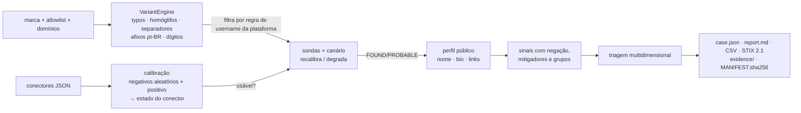

# SÓSIA

**Proteção de marca ou pessoa contra perfis que se passam por ela — OSINT passivo, explicável e mensurável.**
Python 3.11+, **zero dependências**, CLI amigável a pipelines de shell.

```bash
pip install -e .            # ou: PYTHONPATH=src python -m sosia ...
sosia init                  # cria sosia.toml
sosia calibrate --validate  # mede a saúde REAL de cada conector no seu ambiente
sosia scan -c sosia.toml --out runs/marca-2026-10 --format summary
sosia bench                 # benchmark sintético reproduzível (≈10 s)
```

> **Uso responsável.** Verificação passiva de dados públicos de perfis. Sem login, sem contornar CAPTCHA/bloqueios,
> sem rotação de IP/User-Agent, rate limit por host, User-Agent honesto. Use para marca/pessoa que **você representa**.
> Prioridade ≠ veredito jurídico; **revisão humana antes de qualquer denúncia**.

---

## O que o SÓSIA faz de diferente

A enumeração de usernames (Sherlock, Maigret…) e a geração de permutações (dnstwist, AIL) existem. O SÓSIA junta os quatro
passos que costumam ficar soltos — **gerar → calibrar → confirmar → triar** — e trata a incerteza como cidadã de primeira classe:

| # | Princípio | Como está implementado |
|---|---|---|
| 1 | **"Nome impossível" vira calibração do conector** | 3 nomes aleatórios *sintaticamente válidos* + controle positivo; estados `trusted`, `differential`, `soft404`, `blind`, `blocked`, `error`, `unstable`, `unvalidated`, sempre com motivo (`calibrate.py`) |
| 2 | **Soft-404 não é descartado às cegas** | Se o conector "acha" tudo mas o corpo dos negativos é estável e diferente do positivo, usa **impressão digital** do corpo — *e só se passar em validação* (≥2 perfis conhecidos + 6 negativos novos) |
| 3 | **Canário em tempo de varredura** | A cada N consultas, um negativo novo (e, alternando, um positivo). Se falhar: recalibra, reprocessa o período suspeito ou degrada o conector. Drift de layout e CAPTCHA no meio da execução não viram falsos positivos |
| 4 | **Bloqueio ≠ ausência** | 403/429/CAPTCHA/desafio → `inconclusivo` (com motivo), nunca "não existe" |
| 5 | **Bio é evidência, não veredito** | Sinais agrupados, com **negação** ("nunca pedimos senha ou Pix"), mitigadores (fã/paródia), `aceitamos Pix` ≠ pedido de Pix, ofuscação (`p1x`), domínios parecidos/encurtadores |
| 6 | **CRÍTICO é prioridade sustentada por evidência** | Exige: ≥2 grupos independentes de evidência (ou grupo duro + alegação de identidade) **+** bio lida **+** referência à marca **+** existência confirmada **+** sem disclaimer **+** não-allowlist |
| 7 | **Dimensões separadas** | existência · semelhança · vínculo · evidência de abuso · severidade potencial · confiança (nunca um único número opaco) |

Também: ranking de variantes por **massa de probabilidade por família** (re-estimável com `sosia fit-priors` a partir do seu histórico de
takedowns), pacote de evidências com **manifesto SHA-256**, exportação **STIX 2.1**, `diff` entre execuções (semente do *Watch*),
vocabulário de fraude em **pt-BR**, "alavancas psicológicas" de engenharia social (autoridade, urgência, escassez, recompensa, medo,
prova social, isolamento, comprometimento) anotadas por perfil.

## Pipeline



## Comandos

| comando | rede | para quê |
|---|---|---|
| `sosia variants MARCA [--platform x]` | não | variantes ranqueadas, filtradas pelas regras de username da plataforma |
| `sosia platforms` | não | conectores e se foram validados ao vivo |
| `sosia calibrate [--validate]` | sim | estado de cada conector **no seu IP/ambiente**; `--validate` mede acerto real |
| `sosia scan -c sosia.toml --out DIR` | sim | varredura completa + pacote de evidências |
| `sosia triage MARCA --text "bio…"` | não | explica a triagem de uma bio, linha a linha |
| `sosia pivots MARCA` | não | consultas para clones **sem handle parecido** (nome de exibição, dorks) |
| `sosia fit-priors HANDLE aliases.txt` | não | estima massas de família a partir de aliases reais conhecidos |
| `sosia eval rotulados.jsonl` | não | **mede precisão/recall da triagem em perfis reais** rotulados por revisores |
| `sosia diff old/case.json new/case.json` | não | perfis novos, bio alterada, escalonamento de prioridade |
| `sosia bench [--quick]` | não | benchmark sintético (3 experimentos) |

Códigos de saída do `scan`: `0` nada ≥ALTO · `10` há ALTO · `20` há CRÍTICO · `2` uso · `3` nenhum conector utilizável.

```bash
# pipeline de shell: só o que merece atenção, com o porquê
sosia scan -c sosia.toml -q --format jsonl \
  | jq -r 'select(.assessment.priority=="CRITICO") | [.platform,.username,.url,(.assessment.reasons|join(" | "))] | @tsv'
```

## Resultados — leia com cuidado

### Bench sintético (`docs/BENCH_RESULTS.md`, seed 7, 10 marcas fictícias, 600 aliases)

Verdade-terreno gerada por um **atacante simulado independente do motor** (mutações aleatórias, afixos dentro *e fora* do léxico, handles sem
relação com a marca), 12 comportamentos de plataforma (soft-404, SPA, login wall, rate limit, CAPTCHA, drift, instabilidade…) e armadilhas
(revenda legítima que "aceita Pix", perfil oficial com aviso de segurança, fã/paródia, bio vazia).

| experimento | resultado (sintético) |
|---|---|
| **Geração** — recall de aliases descobríveis, orçamento 200 consultas | SÓSIA 24,1% · tipo-dnstwist 14,8% · tipo-Sherlock 2,6%. Em *typos* puros empata com o tipo-dnstwist; a diferença vem dos afixos. **Afixos fora do léxico: ~1%** (teto honesto). Handles sem relação com a marca: **0%** por construção |
| **Existência** — 12 plataformas simuladas | `naive_status`: precisão 27,3%, 8.298 falsos positivos, 222 falsos negativos *silenciosos*. **SÓSIA: 0 FP, 0 FN silencioso**, 1.255 existentes ficam *inconclusivos* (visíveis, com motivo) em plataformas que ninguém consegue julgar |
| **Triagem** — CRÍTICO vs golpe, split de teste | gatilho por palavra-chave (v1.1 como descrito): precisão 51,5%, recall 100%. SÓSIA multissinal: precisão 100%, **recall 42%** (golpes fora do léxico caem em ALTO/MÉDIO). ⚠️ precisão do SÓSIA é **otimista**, ver abaixo |

**O que estes números NÃO são:** taxas de detecção do mundo real; comparação com Doppel/Netcraft/Fortra; execução do Sherlock/dnstwist/Maigret
(os baselines reimplementam a *lógica documentada*, minimamente). As regras de léxico/negação foram escritas pelo mesmo autor do corpus, com
visibilidade dos templates de teste — por isso a precisão da triagem é um *teto*. Para medir de verdade use `sosia eval` com perfis reais
rotulados por dois revisores. Detalhes e bugs que o bench achou no próprio motor: [`docs/DESIGN.md`](docs/DESIGN.md).

### Validação ao vivo (`docs/LIVE_VALIDATION.md`, 2026-10-15, sandbox em nuvem)

17 conectores: **11 passaram** na validação (perfis conhecidos + negativos novos), 3 bloqueados (403), 2 descartados como soft-404, 1 instável→inconclusivo.
Resultado depende de IP/região: **rode `sosia calibrate --validate` no seu ambiente** antes de confiar em qualquer plataforma. Nenhum conector está
marcado como `verified_on` no repositório de propósito.

## Limitações conhecidas (e honestas)

- **Clones sem handle parecido** (copiam nome, logo e discurso) não são encontrados por enumeração. `sosia pivots` gera consultas; o *Watch* de imagem/logo (pHash) é roadmap.
- **Plataformas muradas** (Instagram, Facebook…) tendem a ser inconclusivas sem login. O SÓSIA não contorna isso — e diz que não sabe.
- **Modo diferencial** tem confiança menor (0,65): nunca promove a CRÍTICO sozinho.
- **Priors** (massas de família, pesos de sinais) são hipóteses do autor, não medições. Re-estime com `fit-priors` e valide com `eval`.
- **Léxico** é pt-BR primeiro, en/es mínimo; golpes fora do léxico caem em ALTO/MÉDIO (recall de CRÍTICO 42% no bench de teste).
- Sem verificação de **vínculo oficial recíproco** (link do site oficial → perfil). Link para domínio oficial é só "alegação não verificada".
- Dígitos depois de afixos cobrem poucos padrões; combinação *typo + afixo* tem cobertura baixa (~6% no bench).

## Roadmap (módulos do mesmo projeto)

1. **Core** ✅ variantes · calibração · confirmação · bio · evidências · STIX · bench · validação ao vivo
2. **Bench** — corpus real rotulado (dupla revisão), split por período, publicação por plataforma
3. **Watch** — monitoramento contínuo, mudanças de bio/avatar/links (`diff` é a semente)
4. **Case** — estado do caso, pacote de denúncia por plataforma, acompanhamento
5. **Campaigns** — agrupamento por links/contatos/imagens reutilizadas (cuidado: infraestrutura compartilhada ≠ autoria)
6. Comparação visual (pHash de avatar/logo) e destino dos links (dnstwist-style para domínios das bios)

## Referências

[dnstwist](https://github.com/elceef/dnstwist) (famílias de fuzzing, similaridade) ·
[AIL typo-squatting](https://github.com/typosquatter/ail-typo-squatting) (operadores de mutação) ·
[Maigret](https://github.com/soxoj/maigret) (checkType, `errors` vs ausência, verificação com username fictício) ·
[x-impersonation-guard](https://github.com/wheelieinvestor/x-impersonation-guard) (múltiplos sinais, mitigação de paródia/fã, fila de revisão, evidência) ·
[CISPA brand_impersonation](https://github.com/CISPA-SysSec/brand_impersonation) / *The Imitation Game* (USENIX Security 2024) ·
[Unicode UTS #39](https://www.unicode.org/reports/tr39/) (skeleton: sinal de semelhança, não prova de intenção).

---

### English summary

SÓSIA generates look-alike handles (typos, homoglyphs, separators, pt-BR authority/support/promo affixes, digits), **calibrates every platform connector
before trusting it** (random syntactically-valid negatives + positive control, differential body fingerprinting gated by validation, canary probes during the
scan), treats blocks/CAPTCHAs/rate limits as *inconclusive* — never as absence — and reads profile bios as **contextual evidence**: grouped signals with negation,
mitigators and explainable multi-dimensional triage. `CRITICAL` requires independent evidence groups, a readable bio, brand reference and confirmed existence.
Ships with a reproducible synthetic benchmark (clearly labelled as such), live connector validation, a SHA-256-manifested evidence pack and STIX 2.1 export.
Zero dependencies, Python 3.11+.

MIT © Ridd1kulusC0d3r
